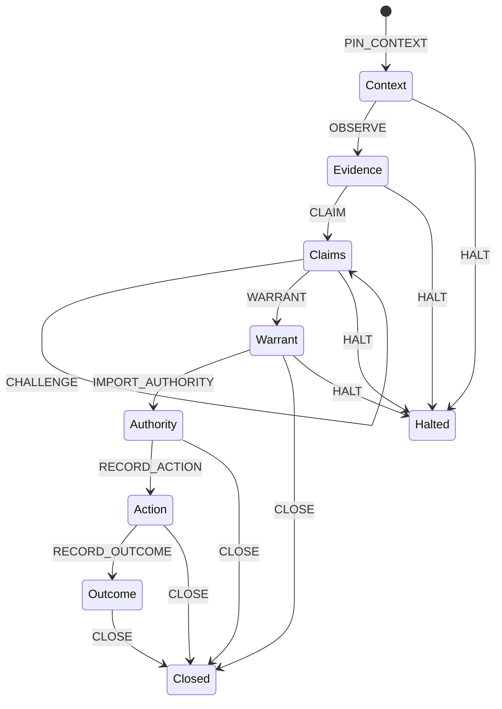

# HumanAIOS Core Machine v0.1

Status: bounded reference implementation for issue #810  
Tool: `tools/humanaios_core_machine_v0_1.py`  
Schema: `schemas/humanaios_core_machine_v0_1.schema.json`  
Authority effect: `NONE`

## 1. Purpose

The Operations repository is an evidence-bearing control system, not a single
business algorithm. Its smallest recurring computation is:

```text
pin context
  → observe evidence
  → state a claim
  → preserve or resolve challenges
  → derive a warrant
  → import external human authorization
  → record an externally observed action
  → record an externally observed outcome
```

HumanAIOS Core Machine (HCM) v0.1 expresses that computation as a compact,
deterministic bytecode and a pure replay machine. This is “machine code” for the
HumanAIOS governance semantics. It is intentionally not x86 or ARM output:
processor-specific output would encode the Python interpreter or compiler, not
the Operations contract.

The implementation composes existing repository contracts:

- `REPOSITORY_COORDINATOR_POLICY.json` supplies the current evaluation-admission
  boundary and authorized actor set.
- `tools/verified_receipts.py` resolves receipts from a separately pinned hash
  chain.
- Repository Coordinator remains the admission-routing system.
- SCVC, Session Graph, and Evidence Graph remain evidence/continuity surfaces.
- Human review remains the source of consequential authorization.

HCM is therefore a deterministic translation and replay layer. It is not a new
Coordinator, trust root, admission system, executor, or merge gate.

## 2. Core invariants

Every successful or halted replay emits these fields:

```json
{
  "authority_effect": "NONE",
  "can_authorize": false,
  "can_execute": false,
  "merge_authority": false,
  "authenticated": false,
  "trust_anchor_authentication": "EXTERNAL_TO_VM"
}
```

Those values are constants, not caller options. Their meaning is precise:

1. A warrant is not authorization.
2. A receipt claim is not its own trust anchor.
3. A comment is not an approved review.
4. Evaluation admission is not implementation acceptance.
5. Admission is not merge authority.
6. Recording an observed action is not performing that action.
7. The VM checks exact bindings but does not authenticate the channel that
   supplied its runtime trust anchors.

The protected caller is responsible for supplying the policy document, subject
head, receipt-chain head, and issuer identities from independently authenticated
sources. A bytecode program cannot embed those runtime values as sufficient
proof of itself.

## 3. Binary format

All multi-byte integers use big-endian order.

### 3.1 Header

| Offset | Size | Field | Rule |
|---:|---:|---|---|
| 0 | 8 | magic | `HAIOSMC\0` |
| 8 | 1 | format version | `0x01` |
| 9 | 1 | flags | zero in v0.1 |
| 10 | 2 | reserved | zero in v0.1 |
| 12 | 32 | policy digest | SHA-256 of canonical policy JSON |
| 44 | 4 | instruction count | 1–256 |

### 3.2 Instruction record

| Size | Field | Rule |
|---:|---|---|
| 1 | opcode | value from the v0.1 instruction table |
| 4 | operand length | 0–65,536 bytes |
| N | operand | canonical UTF-8 JSON object |

Canonical JSON uses sorted object keys, UTF-8, no insignificant whitespace, and
no floating-point values. Duplicate object keys are rejected. Raw payload keys
such as `body`, `content`, `email`, `message`, `private`, `secret`, `text`, and
`token` are excluded from bytecode operands. Claims and sources use digests and
opaque references instead.

### 3.3 Trailer

The final 32 bytes are SHA-256 over the complete header and instruction stream.
The decoder checks the trailer before decoding an operand. It rejects unknown
opcodes, truncated fields, excess bytes, reserved bits, oversized operands, and
non-canonical JSON.

Maximum bytecode size is 1 MiB.

## 4. Instruction set

| Opcode | Name | State effect |
|---:|---|---|
| `0x10` | `PIN_CONTEXT` | Bind repository, exact subject head, policy digest, purpose, and optional source issue. Must be first. |
| `0x20` | `OBSERVE` | Register a provenance reference, source digest, and epistemic state. |
| `0x30` | `CLAIM` | Bind a claim digest to one or more prior observations. |
| `0x40` | `CHALLENGE` | Preserve an open challenge or resolve it with prior evidence. |
| `0x50` | `WARRANT` | Bind supported claims to an evaluation-admission action and scope. |
| `0x60` | `IMPORT_AUTHORITY` | Resolve an external human-authorization receipt against runtime-only pins. |
| `0x70` | `RECORD_ACTION` | Resolve and record an external action-observation receipt. No action handler exists in the VM. |
| `0x80` | `RECORD_OUTCOME` | Resolve and record an external outcome-observation receipt. |
| `0x90` | `CLOSE` | Emit the deterministic replay receipt. Must be terminal. |
| `0xFF` | `HALT` | Emit a fail-closed receipt carrying an opaque reason code. Must be terminal. |

## 5. Static state machine

The compiler and decoder both run the same static validator. This means a
malformed program cannot become acceptable merely by bypassing the compiler and
constructing binary bytes directly.



The v0.1 program contains one context and at most one warrant, authority import,
action, and outcome. Multiple observations, claims, and challenges are allowed.
Object identifiers are unique across the whole program.

## 6. Epistemic rules

An observation carries one of:

- `OBSERVED`
- `ATTESTED`
- `UNKNOWN`
- `DISPUTED`

A claim carries one of:

- `OBSERVED`
- `INFERRED`
- `UNKNOWN`
- `DISPUTED`

Every claim cites existing observations. A warrant cites existing claims. Claims
in `UNKNOWN` or `DISPUTED` state cannot support a warrant. An open challenge on
a cited claim also blocks the warrant. A resolved challenge must cite evidence.

This is a structural rule. It does not upgrade an observation or claim to truth.

## 7. Authority import

`IMPORT_AUTHORITY` supports the current bounded pilot action:

```text
EVALUATION_ADMISSION
```

The instruction contains only:

- an internal binding ID;
- an external receipt ID;
- the warrant ID;
- the minimum receipt strength (`ATTESTED` or `CRYPTO_VERIFIED`).

The rest comes from runtime state that is not in the bytecode:

- the exact subject head;
- the canonical Repository Coordinator policy document;
- the pinned receipt-chain head and receipt events;
- the authorization witness issuer;
- the action/outcome observation witness issuer.

The VM recomputes the policy digest and requires it to match both the bytecode
header and `PIN_CONTEXT`. It then checks the policy still contains:

- `EVALUATION_ADMISSION_IS_NOT_IMPLEMENTATION_ACCEPTANCE`;
- `ADMISSION_IS_NOT_MERGE_AUTHORITY`;
- `required_issue_state = ADMISSION_REQUESTED`;
- `authority_effect = EVALUATION_ONLY`;
- `merge_authority = false`.

The external authorization receipt must resolve from the pinned receipt chain
and match all of these fields:

| Field | Required value |
|---|---|
| `receipt_type` | `HUMAN_AUTHORIZATION` |
| `subject` | exact `repo:<owner/name>@<subject-head>` |
| `action` | warrant action |
| `scope` | warrant scope |
| `issuer` | runtime authorization issuer |
| `authority_scope` | `EVALUATION_ONLY` |
| `actor` | member of the policy’s `authorized_actors` |
| `review_state` | `APPROVED` |
| `source_kind` | `GITHUB_PULL_REQUEST_REVIEW` |
| `issue_state` | `ADMISSION_REQUESTED` |
| `subject_head_sha` | exact context head |
| `warrant_id` | exact current warrant |
| `merge_authority` | `false` |

An issue comment fails the `source_kind` test even when its wording resembles an
admission command. A receipt bound to an earlier PR head fails the subject test.
A consumed one-time receipt fails in `tools/verified_receipts.py` before these
additional bindings are considered.

## 8. Action and outcome records

HCM has no callback, subprocess, network client, shell invocation, repository
mutation, or arbitrary function-dispatch instruction. `RECORD_ACTION` means an
independent witness already observed the action and emitted an
`ACTION_OBSERVATION` receipt. `RECORD_OUTCOME` applies the same rule to an
`OUTCOME_OBSERVATION` receipt.

The action receipt binds:

- exact repository and subject head;
- warrant action and scope;
- authorization receipt ID;
- warrant ID;
- `event_state = OBSERVED`.

The outcome receipt binds:

- exact repository and subject head;
- warrant action and scope;
- action receipt ID;
- action object ID;
- `event_state = OBSERVED`.

This makes the VM a replayable causal-chain validator, not an executor.

## 9. Result states

`CLOSE` returns one of:

| Status | Meaning |
|---|---|
| `READY_FOR_EXTERNAL_AUTHORITY` | Evidence and warrant are structurally valid; no authority receipt was imported. |
| `AUTHORIZATION_RECEIPT_BOUND` | External authorization receipt matched; no action observation was imported. |
| `ACTION_OBSERVED` | External action observation matched; no outcome observation was imported. |
| `OUTCOME_OBSERVED` | The complete observed chain matched. |

Any runtime mismatch returns `HALTED`. Detailed external values are not echoed.
When a diagnostic detail exists, the receipt includes a truncated digest of that
detail rather than the value itself.

Receipt IDs are content-derived:

```text
HCM- + first 24 hex characters of SHA-256(canonical receipt without receipt_id)
```

The same bytecode and runtime evidence therefore produce the same receipt.

## 10. Command-line interface

Compile:

```bash
python3 tools/humanaios_core_machine_v0_1.py \
  compile program.json program.hcm
```

Disassemble and integrity-check:

```bash
python3 tools/humanaios_core_machine_v0_1.py \
  disassemble program.hcm
```

Replay with runtime pins:

```bash
python3 tools/humanaios_core_machine_v0_1.py run program.hcm \
  --policy REPOSITORY_COORDINATOR_POLICY.json \
  --subject-head <exact-pr-head> \
  --receipt-ledger <verified-receipts.jsonl> \
  --receipt-head <independently-pinned-chain-head> \
  --authorization-issuer <protected-review-witness> \
  --observation-issuer <protected-action-witness> \
  --output <receipt.json>
```

The command returns non-zero when replay halts.

## 11. Limits and falsifiers

This pilot would be falsified as an adequate encoding of the bounded core if any
of these tests succeeds when it should fail:

1. modified bytecode passes its digest check;
2. a claim with missing evidence forms a warrant;
3. an open challenge silently disappears;
4. a comment satisfies the human-review requirement;
5. authorization for an earlier head binds to the current head;
6. policy with merge authority enabled passes the v0.1 boundary;
7. an action or outcome records without its prior receipt binding;
8. the VM performs an external action;
9. a result changes any of the four non-authority constants.

The pilot does not establish that a receipt issuer or runtime pin is authentic.
It checks exact binding after a protected caller supplies those trust anchors.
Production use therefore requires protected-CI execution and an independently
authenticated witness. Local success is implementation evidence, not admission
or deployment authorization.

## 12. Evolution boundary

Future versions may add more authority domains, graph operands, or signed trust
roots only through a format-version change and explicit policy mapping. Unknown
opcodes and non-zero flags are rejected in v0.1 so later semantics cannot be
silently interpreted by an earlier runtime.

No v0.1 extension may turn evidence, a warrant, an evaluator result, or a
Coordinator route into merge authority. That separation is inherited from the
Repository Coordinator policy rather than defined anew here.
